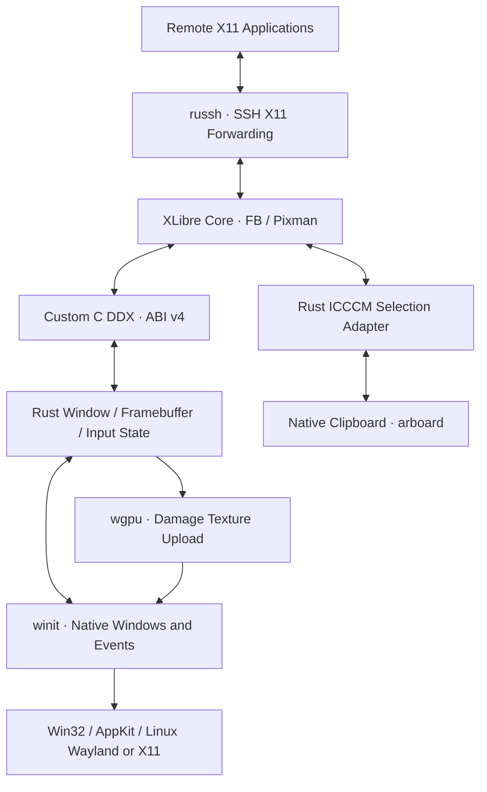

# 架构与实现边界

## 所有权与线程

主线程拥有 winit EventLoop、原生窗口、wgpu surface/device/queue、本地剪贴板，以及非阻塞轮询的 X11 Selection 适配器。XLibre 的 `dix_main` 位于独立工作线程；所有 X Server 数据结构只在该线程访问。C DDX 将帧缓冲借用到 Rust 回调中，Rust 在调用返回前完成有界复制，不持有 C 缓冲指针。

共享状态由 `Arc<Mutex<Backend>>` 管理。ABI 使用不透明 handle 和完整 `WayxApi` 回调表，带版本和结构体尺寸检查。禁止把 Rust 对象、字符串或 Vec 布局当成 C 类型。销毁 handle 必须等待所有调用结束。无效非空指针无法由 ABI 安全验证，调用方仍有义务保证指针有效。

XLibre 安装的进程级信号处理器可能在工作线程返回后仍存在，因此客户端将核心库保持加载至进程退出。嵌入模式在支持 setitimer 的平台禁用全局调度定时器；原生窗口关闭或 UI 出错后请求 XLibre 退出并等待工作线程结束。

## 显示路径

当前 C DDX 复用固定版本 XLibre VFB 的软件屏幕初始化和输入设备。X11 请求、资源、扩展、Pixmap 以及 Pixman 绘图都由真正的 XLibre 核心实现。屏幕限定为单个 depth-24、32-bpp、little-endian XRGB8888 framebuffer。

Damage 记录在屏幕 Pixmap 上。8 毫秒定时器将受损矩形和实际 stride 传给 Rust。Rust 校验矩形、行跨度与内存范围，将 XRGB alpha 归一化为 255，并合并待呈现的 Damage。wgpu 只上传受损纹理区域，通过全屏三角形和纹理采样呈现；rootful 单输出窗口大小变化通过 RandR 重建帧缓冲；rootless 则更新对应 X11 窗口的几何并重新分配 Composite Pixmap。

内存上限：单帧缓冲 256 MiB，所有窗口总计 512 MiB、最多 1024 个窗口，单轴不超过 16384。显卡自身能力可能更低。Rust 的窗口模型维护 ID、父子关系、标题、可见性、焦点和递归销毁，默认 DDX 注册整个 X 屏幕；`--rootless` 则由 Composite 手动重定向根窗口的子窗口，将每个顶层窗口的独立 Pixmap 注册到 Rust 窗口模型。Damage 相对 Pixmap 的坐标经边框偏移校正后上传；嵌套子窗口保留在同一 Pixmap 中。窗口销毁和 Pixmap 重建会解除 Damage 跟踪，避免继续访问已释放的服务器对象。

## RandR 屏幕与输出

DDX 替换 VFB 的尺寸回调，为每次改变分配新的有界软件帧缓冲，保留重叠像素，
原地更新屏幕 Pixmap 头部及 root clip，刷新 Rust 帧缓冲和 RandR 通知后释放旧存储。
默认内存模式支持动态尺寸；文件映射模式不支持。Native 单输出桌面 resize 同时更新
输出模式；多输出桌面由 RandR 客户端管理布局，避免宿主 resize 隐式重排多个输出。
`-wayx-monitor WxH+X+Y` 定义最多 16 个启动输出并激活相应 CRTC；屏幕尺寸由布局
包围区域决定。宿主显示器自动同步及每屏 DPI 尚未实现。

## 客户端软件 OpenGL

DDX 注册 client-only GLX provider，提供 24-bit XRGB、单/双缓冲及 depth/stencil
FBConfig。XLibre 处理真实 GLX 1.4 控制协议，远端 Mesa drisw/llvmpipe 建立 direct
软件上下文并通过 X11 PutImage 传输颜色图像。OpenGL 版本取决于远端 Mesa；不把
GLX 协议版本或 wgpu 的能力当作应用的 OpenGL 能力。

每组颜色/深度/双缓冲组合同时提供 window/pixmap-only 和 Pbuffer 配置。
前者的 Pbuffer 限制为零，XLibre 不在协议中发送对应属性，兼容旧版 Mesa
对这些字段的严格匹配；后者保留原有 16384 尺寸上限。Ubuntu 16.04 的
Mesa 18.0.5 已验证修复前同客户端报无匹配 FBConfig，修复后真实绘图通过。

构建使用固定 libglvnd 头文件，不链接宿主 OpenGL。GLX 解码器中的 GL 调用改走
上游 procedure-dispatch 接口；provider 拒绝所有服务端间接上下文，ForceCurrent
也拒绝对 direct-context tag 执行服务端 GL 请求。测试检查错误返回，避免无宿主
GL dispatch 时意外执行绘图。此路径不提供服务端间接 GL、DRI2/DRI3 或宿主 GL GPU
加速。帧缓冲和 C ABI 保持现有约束，新增 GLX provider 不改变几何同步的 ABI 约束。

核心在所有平台禁用 MIT-SHM，避免 SSH/回环转发被误判为可访问宿主共享内存。
回归包括无 MIT-SHM 的 TCP Mesa VBO 绘制、OpenGL 像素回读、OGRE 实际绘制，
分别验证 rootful/rootless 的 Damage 像素；原生窗口测试另检查 wgpu 呈现的颜色。
当前不据此宣称特定远端 ROS Kinetic/RViz 安装已完成实机验收。

## 窗口管理

Rust 内部 X11 连接同时驱动 Selection 与 WM_S0/SubstructureRedirect，避免两套事件消费者。处理 MapRequest、ConfigureRequest、常用 EWMH ClientMessage，维护客户端列表、堆叠顺序和活动窗口。DDX 将 ICCCM 尺寸约束、瞬态关系、坐标及窗口状态以固定 64 字节结构同步到 Rust；原生 MOVE/RESIZE/STATE 回到 C 的服务器线程执行。新建窗口保持隐藏，直到显式映射，避免未完成初始化的根桌面被呈现。

原生关闭先发送 WM_DELETE_WINDOW；未声明协议时终止该 X11 客户端。鼠标点击提升并聚焦普通窗口，hover 不改变层级。override-redirect 保留弹出行为。Linux X11 宿主验证了双向几何与瞬态父窗口关系；Wayland 全局定位受协议限制，macOS/Wayland 的原生 owner 关系仍需专用实现及原生验证。ABI v4 拒绝旧版本插件，升级必须重建核心。

## 输入

winit 物理键转换成显式 USB HID usage，再由 C DDX 映射为 evdev XKB keycode。没有依赖 Rust enum 序号或直接转型为平台扫描码。鼠标坐标按 framebuffer/原生窗口比例转换；C DDX 调用 XLibre 的 QueuePointerEvents/QueueKeyboardEvents。

按键和鼠标按钮保持有序；只合并相邻、同窗口的 motion。队列有 4096 条上限，溢出明确报错，不静默丢掉 key-up。失焦释放已按下的键和按钮。物理键自动重复交给 XKB。滚动以独立的 XI2 水平/垂直相对 valuator 传入，保留小数增量；XLibre 自动累积并为旧客户端模拟按钮 4–7，不再重复注入滚轮按钮。每条事件每轴限制为 32 行，以限制异常大输入造成的按钮事件数量。操作系统提供的惯性与自然滚动方向原样保留。

原生 IME Commit/Preedit 直接进入 Rust XIM 服务（`@im=wayx`），与 Selection/WM
共享内部 X11 连接和事件循环，不再投递到 DDX 不处理的 TEXT 队列。XIM 协议和
COMPOUND_TEXT 编码由 `xim` 提供，XLibre 负责传输 X11 请求。单条文本限制 8 KiB；
按 XIC 焦点、真实 X11 输入焦点及原生顶层窗口共同校验目标，避免串窗。回调式
预编辑发送 Start/Draw/Done；候选窗坐标取 XIC spot 并换算 framebuffer 缩放。
`PreeditNothing`/`PreeditPosition` 使用 cosmic-text 与系统字体栅格化本地预编辑层，
只覆盖 GPU 纹理，不修改远端 framebuffer；结束时恢复原图。组合期间抑制物理键，
并平衡组合开始前已转发的 key-down；失焦、reset、销毁和断连清理上下文。
Linux 真实 Xlib/XLibre 协议回归已覆盖 Unicode、预编辑及焦点生命周期；各宿主实际
输入法交互仍待验收。当前 XKB 默认布局为 us；可通过 XLibre 支持的 XKB 配置或 X11 客户端切换布局。

## 剪贴板

C ABI 提供 UTF-8 缓存读写；真实 X11 Selection 协议由 Rust 内部 X11 客户端连接 XLibre 完成。这样不从 DDX 工作线程直接调用原生剪贴板 API。

适配器通过 XFixes 观察 CLIPBOARD 所有者变化，支持 TARGETS、UTF8_STRING、STRING、TIMESTAMP，以及大文本 INCR 接收/发送。单次文本上限 16 MiB，最多 32 个并发 INCR 发送，超时发送会被清理。只同步 CLIPBOARD，不同步 PRIMARY，不实现图片、文件列表、MULTIPLE 或剪贴板管理器持久化。

本地剪贴板由 arboard 使用平台机制处理。Linux Wayland 使用 data-control 支持，实际可用性取决于 compositor/会话策略。X11 选择转换已进行真实 XLibre 测试；macOS/Windows 原生剪贴板仍需对应系统运行 CI 和交互测试。

## SSH 与认证

SSH 会话和所有 X11 channel 使用 russh。只允许已记录的原始主机公钥；未知和变更密钥拒绝连接，不自动信任首次连接，也不绕过证书策略。每个会话产生新的随机 spoof cookie；每条 X11 channel 在连接本地 X Server 前验证 X11 setup 的字节序、协议版本、认证名称、长度和 cookie，再替换成本地 Xauthority 中的 cookie。

本地真实 cookie 不经 SSH X11 forwarding 请求传给远端。Unix 系统优先本地 Unix socket，其他情况使用回环 TCP。默认示例不开放 X11 TCP；不使用 `xhost +` 或 `-ac` 作为用户启动方式。`-ac` 仅用于短时隔离的测试显示：Unix 测试禁用 TCP，Windows CI 使用 TCP 覆盖平台监听。用户启动使用 `-auth`。

测试以本地临时密钥和真实加密 russh 会话执行，不需要外部服务器、用户密钥或虚构的远端认证。CLI 可通过命名的环境变量读取加密身份密钥的密码。未实现 SSH Agent、OpenSSH config、ProxyJump、连接 UI 或重连恢复。

## 平台状态

| 范围 | Linux | Windows | macOS |
| --- | --- | --- | --- |
| Rust 状态、认证和加密 SSH 回归 | 原生 CI 通过 | 原生 Rust CI 通过 | 原生 Rust CI 通过 |
| C ABI 与核心回调 | C harness 与真实核心通过 | DLL 链接与真实核心回调通过 | 真实核心回调通过 |
| Rust winit/wgpu 显示后端 | 原生 X11 surface 与 Vulkan 软件渲染已运行 | Win32 窗口与 DX12 软件呈现已运行 | AppKit 窗口与 Metal 呈现已运行 |
| XLibre 自定义 DDX | 固定提交构建、协议与输入测试通过 | 核心、协议、原生呈现与含空格目录运行包通过 | 核心、协议、原生呈现与搬移运行包通过 |
| 本地 Wayland surface | 已启用编译，当前环境无 compositor，未运行 | 不适用 | 不适用 |
| 远端原生 Wayland 应用 | 不属于 SSH X11 forwarding 支持范围 | 同左 | 同左 |

CI 配置并不等于已执行成功。完整跨平台发行需要分别解决 XLibre 的平台依赖、库打包、线程/信号行为和原生交互验证。提交 a496bce 的 Rust 三平台及 Linux 核心 CI（run 39709583984）与 Windows/macOS 原生核心 CI（run 39709583993）均已通过。Linux rootful/rootless 与窗口管理已运行验证；各平台正式发行验收仍未完成。

Rootless 集成测试额外覆盖完全遮挡下绘制、边框坐标、子窗口合成、独立输入、客户端 resize、unmap/remap 和窗口生命周期。原生测试通过宿主 X11 查询两个实际独立窗口，并关闭其中一个，确认另一个保留。

## 更新调度与线程唤醒

XLibre 在线程自己的 BlockHandler 批量处理输入及累计 Damage，不再由固定 8 ms 定时器扫描。
窗口生命周期钩子和属性写入回调标记元数据；只在标记后读取标题/窗口属性。
C Bridge 仅对实际输出变化设置 pending，由 output_flush 合并通知 UI；空批次不通知。

ABI v4 保留 v3 的 input_fd、input_ack、output_flush，并追加 window_geometry。input_fd 返回 Backend 拥有的回环
socket，DDX 仅注册/注销，不关闭；生产者在队列入队后写入唤醒字节，消费者先确认
通知再处理有界输入批次，未处理完的输入重新触发通知。队列和通知状态由同一锁保护。

UI 使用 EventLoopProxy 的合并事件，消费前清除 pending，避免发布/清除顺序导致丢唤醒。
内部 X11 连接由一次性 readiness watcher 唤醒，watcher 不读取协议数据；UI 消费事件后
重新注册 readiness。销毁时先停止 watcher 并注销，再释放连接。工作线程完成（含失败）
同样通知 UI。仅保留原生剪贴板兼容检查的 250 ms 截止时间与暂时性 surface 失败的
按需重试截止时间；正常静止窗口不提交画面。系统曝光/恢复、尺寸及 IME 变化仍能重绘。

### 避免协议应答触发自激唤醒

WM 初次同步查询窗口树，此后使用 Create/Destroy/Reparent/Configure 通知维护完整堆叠，
再过滤 managed clients；仅无法定位 ConfigureNotify 的兄弟窗口时重新查询，不在空闲 tick 查询。
IME 被动 cursor 查询使用按 native ID 的缓存；XIM、焦点及结构事件使缓存失效。观察实际
焦点及其祖先的 Focus/Structure/Substructure 通知，保留已有事件掩码。预编辑和文本提交
直接校验实际 X 焦点，防止尚未消费的焦点通知造成串窗。

XFixes 订阅完成后读取初始 clipboard owner，此后依赖 selection 通知，删除周期性
GetSelectionOwner。原生剪贴板兼容检查仍保留，但不会因此制造 X11 查询。

UI 只在 about_to_wait 执行一轮同步。同步前暂停一次性 readiness，在同一门锁下
检查通知是否仍属于当前注册代次，忽略已过期应答通知。同步查询可能把事件读入
x11rb 的内部缓存，重新注册 socket 前先检查并保留这类事件，安排下一批处理；
不能只等待 socket 再次可读。DDX 先消费输入，再同步本批输出；没有 metadata 或
Damage 时跳过顶层窗口扫描。

回归验证除了静止不 present，也检查累计进程 CPU 时间，以及重复 100 次 WM tick/
IME cursor 不增加 X11 请求序列号。Windows 使用 GetProcessTimes，Linux 使用 /proc。

POSIX SIGTERM/SIGINT 使用信号安全的 self-pipe 唤醒 XLibre 等待集；信号即使落在
UI 线程也能触发正常退出，不依赖周期性 X11 请求碰巧唤醒服务器。

### 双向尺寸同步

ResizeWindow、ChangeBorderWidth 钩子独立标记几何变化，不依赖客户端绘制 Damage。
原生 resize 输入也显式标脏；DDX 在消费输入后同步窗口及 framebuffer，再发布批次。
MOVE/RESIZE 的 detail 携带非零请求序号，input_poll 只领取请求，不产生确认。
DDX 处理完成后，在同一份 GeometrySnapshot 中提交最终 WindowState、宽高和完成序号。
window_geometry 暂存完整快照，output_flush 在 Backend 锁内一次性发布，并推进窗口的
geometry_generation。映射也延迟至 flush，避免新窗口使用尚未提交的初始状态。
即使请求被拒绝或被约束到原尺寸，也提交实际结果；销毁丢弃暂存快照。
有待确认请求时强制采集几何，不依赖 metadata_dirty 或 Damage。

原生几何配置使用 SubstructureRedirect 所有者的窗口管理器上下文同步执行。
serverClient 的 ConfigureWindow 会先把 ConfigureRequest 转交内部 WM，Success
并不保证 drawable 已改变；不能把这种异步转交当成完成。远端 X11 请求仍经过普通
WM 策略。协议测试刻意暂停 WM tick，验证本地请求的几何应用不依赖后续往返。

原生窗口等待最新本地请求的确认期间，不使用旧 framebuffer 尺寸反向调整窗口。
程序发起的尺寸调整回声不重复发送给 XLibre；过期 Resized 事件先与实际客户区比较。
创建时确认初始尺寸，忽略尚未达到目标的初始化瞬态；确认在 GPU 初始化前进行，
避免阻挡初始化期间发生的真实用户调整。最小化期间不强制恢复客户区大小。

Windows 原生 CI 在带认证的 rootless 空载 CPU 检查后，创建不绘制的被动窗口，
验证五秒几何稳定性、X/宿主客户区一致、连续调整、ICCCM 约束及最小化恢复。
Linux 同一夹具验证被动窗口稳定性和远端 resize 的双端几何一致性。

位置同步同样以 MOVE.detail 请求序号及 output_flush 的最终状态作确认。
本地移动尚未确认时忽略旧位置快照；只有 X 位置实际改变或最新请求完成确认时，
才产生原生位置目标。原生移动事件先比较实际外框位置以丢弃过期通知，再读取客户区
原点；原生客户区原点对应 X 外边框原点，装饰偏移由 winit 的物理 inner/outer
位置之差换算。保留桌面负坐标，不把坐标乘以 DPI 比例；X border 已由 DDX
从 drawable 原点中扣除，不再重复扣减。实际多屏、不同 DPI 行为仍需 Windows 验收。

UI 仅在已提交 generation 改变时向同步状态机传入整份几何，尺寸决策也使用
快照宽高，不用可能处于下一批上传中的 framebuffer 尺寸推断确认结果。
双向位置相等时不执行配置；原生位置目标在调用 OS 前即消费，回声不再送回 X。
新的本地移动取消旧目标，避免拖动中残留目标被每轮重新换算并再次发起。
UI 在事件批次结束时发送连续移动的最后一个值，遇到其他输入或另一个窗口的移动
先提交前一段；Backend 再合并相邻同窗口 MOVE，保留 resize、按键和状态等顺序边界。
不引入拖动定时器。协议测试检查 400 个排队移动只产生至多两次 ConfigureNotify，
原生几何夹具覆盖双向移动、负坐标和非零 X border；Linux 夹具在无 WM 的 Xvfb 上
模拟 ICCCM 合成位置通知，以触发 winit 的真实 Moved 路径。

快照单元测试穿插领取输入、Damage、暂存和 flush，验证 UI 只能看到完整旧/新版本。
原生夹具额外启用持续重绘，按约 3 ms 间隔执行 300 步移动，并统计实际原生位置
纠正调用；服务器接受本地移动时，调用增量必须为零。Windows 分支由原生 CI 执行。
